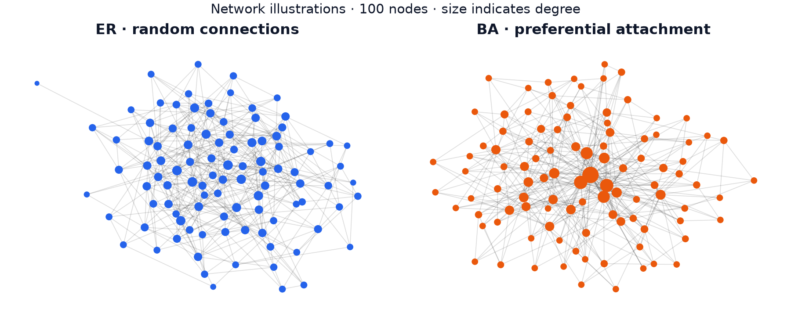
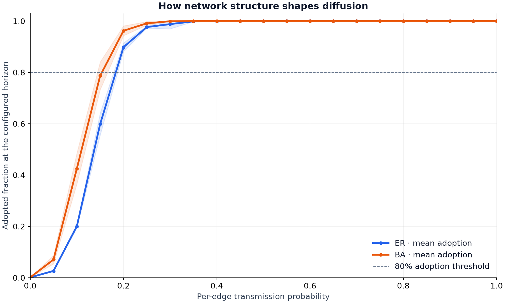
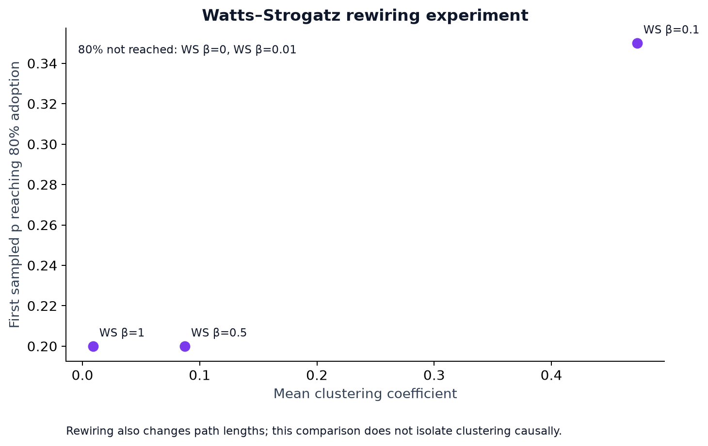

# Abstract

Network topology can change how quickly information spreads, but comparisons
require a specified transmission mechanism, time horizon, and outcome measure.
This study examines synchronous susceptible-infected (SI) diffusion on
Erdos-Renyi (ER), Barabasi-Albert (BA), and Watts-Strogatz (WS) networks. Each
network contains 800 nodes, with mean degree approximately eight. We use
5 independent graphs per configuration, 30 diffusion trials per
graph and probability, and 21 sampled transmission probabilities,
producing 22,050 trial outcomes across seven configurations. At a
10-round horizon, the fitted 50% adoption midpoints are 0.139
for ER and 0.111 for BA, while both have a sampled 80% adoption
threshold of 0.20. WS configurations with little rewiring fail to
reach 80% adoption within the horizon, even at certain transmission. The
regular lattice's coverage at probability one is explained exactly by its
finite-radius neighborhood. We report pointwise graph-level uncertainty,
per-trial seeds, and reproducible analysis artifacts. The findings describe
finite-horizon dynamics under a stylized mechanism; they do not establish a
causal clustering effect, a phase transition, or predictions of real-world
misinformation behavior.

# Introduction

Misinformation motivates questions about how network structure enables rapid
spread. Synthetic networks can help isolate assumptions and build experiments,
but they do not encode content truth, platform incentives, or individual beliefs.
The scientific question addressed here is narrower: **under one transmission
process, how does network topology change mean adoption within a fixed horizon?**

Random-graph, preferential-attachment, and small-world models provide contrasting
structures [1-3]. Prior cascade and social-contagion research motivates the
importance of structure [4,5], but those studies use different mechanisms and do
not validate the SI model used here.

The contribution is a transparent experimental workflow: a single simulation
implementation shared by the command-line runner and notebook, approximately
degree-matched network comparisons, independent graph replication, explicit
outcome definitions, and auditable numerical records. The report is an
exploratory simulation study, not a peer-reviewed publication or empirical
analysis of platform data.

# Methods

## Network construction

All reference networks contain $n=800$ nodes. ER networks use
$G(n,8/(n-1))$, giving expected mean degree eight. BA networks use preferential
attachment with four edges added for each arriving node, giving mean degree
close to eight. WS networks start from a ring lattice with eight neighbors per
node and rewiring probabilities $\beta\in\{0,0.01,0.1,0.5,1\}$.

The comparison approximately matches average degree; it does not match degree
sequences, path lengths, clustering, or realized edge counts. Disconnected
networks are retained. Graph-level mean degree, clustering, and largest-component
coverage are recorded rather than assumed equal. WS rewiring preserves the edge
count but changes multiple structural properties simultaneously.



## Transmission process

Let $I_t$ be the adopted set after round $t$. At time zero, one uniformly sampled
node is adopted. Each node in $I_t$ independently attempts transmission to each
neighbor outside $I_t$ with probability $p$. Successful transmissions join
$I_{t+1}$ simultaneously. Adoption is permanent, and previously adopted nodes
can attempt transmission again in later rounds.

For a susceptible node with $k$ adopted neighbors, the conditional probability
of adoption in one round is

$$
\Pr(v\in I_{t+1}\mid v\notin I_t,k)=1-(1-p)^k.
$$

The outcome is the adopted fraction at the configured horizon $T$,

$$
A_T(p)=\frac{|I_T|}{n}.
$$

We set $T=10$. A quiet round does not terminate the process because
subsequent repeated attempts can succeed. Newly adopted nodes cannot transmit
until the next round. With $p=0$, the outcome is $1/n$; with $p=1$, adoption
reaches the source's graph-distance-$T$ neighborhood. This repeated-attempt SI
process differs from an independent-cascade model with a single transmission
opportunity per newly active edge.

## Replication and uncertainty

For every configuration we sample 5 independent graphs and perform
30 trials per graph at each of 21 probabilities on an equally
spaced grid from zero to one. Each trial samples a source and a fresh transmission
trajectory. The master seed is 42; all graph and diffusion seeds are
retained. Runs at different probabilities are independently seeded rather than
paired by source or transmission draws.

Let $Y_{g,r}(p)$ denote adoption for graph $g$ and trial $r$. We first calculate
the within-graph mean, $\bar Y_g(p)$, then the mean across graphs,
$\bar A_T(p)$. If $s_G(p)$ is the sample standard deviation of graph-level means,
the reported pointwise interval is

$$
\bar A_T(p)\ \pm\ t_{0.975,G-1}\frac{s_G(p)}{\sqrt G}.
$$

Intervals are clipped to $[0,1]$. They describe uncertainty in mean adoption
across graph sampling and finite within-graph simulation, not individual cascade
ranges. With only 5 graph replicates, coverage relies on a coarse
Student-t approximation. The intervals are pointwise, not simultaneous bands.
We do not perform a formal significance test of topology differences.

## Two different outcome summaries

The empirical threshold is

$$
\hat p_{80}=\min\{p\text{ on the tested grid}:\bar A_T(p)\geq0.8\}.
$$

It is undefined when the criterion is never reached. This sampled statistic has
resolution 0.05 and is reported without a threshold confidence interval.
It is a finite-horizon operational measure, not a critical point established by
finite-size scaling.

For curves that bracket 50% adoption, we fit the descriptive logistic function

$$
f(p;\alpha,p_0)=\frac{1}{1+\exp[-\alpha(p-p_0)]}
$$

by nonlinear least squares, with $0\leq\alpha\leq1000$ and $0\leq p_0\leq1$.
The parameter $p_0$ is the fitted 50% midpoint, not $\hat p_{80}$. These are
unweighted fits to mean adoption values, not logistic regression on individual
binary observations. We record mean squared error and omit unsupported fits
for flat curves or curves that do not bracket 50% adoption. Fit uncertainty is
not estimated.

# Results

## ER and BA comparison

Table 1 reports the reference summaries. The realized mean degrees are
7.928 for ER and 7.960 for BA. ER's mean largest-component fraction
is 0.99975; BA networks are connected in the sampled reference set.

| Network | Mean degree | Clustering | Fitted midpoint | Sampled 80% threshold |
| :--- | ---: | ---: | ---: | ---: |
| ER | 7.928 | 0.010 | 0.139 | 0.20 |
| BA | 7.960 | 0.041 | 0.111 | 0.20 |
| WS ($\beta=0$) | 8.000 | 0.643 | - | NR |
| WS ($\beta=0.01$) | 8.000 | 0.626 | - | NR |
| WS ($\beta=0.1$) | 8.000 | 0.473 | 0.242 | 0.35 |
| WS ($\beta=0.5$) | 8.000 | 0.087 | 0.147 | 0.20 |
| WS ($\beta=1$) | 8.000 | 0.009 | 0.141 | 0.20 |

Table 1: Descriptive summaries of the reference experiment. NR means the 80%
criterion was not reached on the sampled grid. A dash denotes an unreported
midpoint because the curve did not bracket 50% adoption. Clustering is averaged
across graphs; it is not a controlled causal treatment.

BA has an earlier fitted midpoint than ER in this run. At $p=0.10$, mean adoption
is 42.5% for BA and 20.0% for ER. At $p=0.15$, the corresponding values
are 78.7% and 59.9%. At $p=0.20$, both exceed 80% mean adoption. Their
sampled thresholds therefore coincide despite different midpoints.

| Probability | ER mean [95% interval] | BA mean [95% interval] |
| ---: | ---: | ---: |
| 0.10 | 20.0 [19.3, 20.8] | 42.5 [36.5, 48.5] |
| 0.15 | 59.9 [55.5, 64.2] | 78.7 [73.3, 84.1] |
| 0.20 | 89.8 [88.1, 91.5] | 96.2 [94.3, 98.1] |

Table 2: Mean adopted fraction and pointwise 95% graph-level intervals at selected
probabilities. Values are percentages of nodes. These intervals do not represent
uncertainty in the fitted midpoint or threshold.



BA hubs and graph-distance structure are plausible contributors to earlier
adoption under this mechanism. The experiment does not isolate their individual
contributions. A finer probability grid may distinguish threshold behavior that
the current grid cannot resolve.

## Watts-Strogatz rewiring

The regular lattice and the $\beta=0.01$ setting never reach 80% mean adoption
within 10 rounds on the tested grid. At $p=1$, their mean adoption fractions
are 0.10125 and 0.42005, respectively. For $\beta=0.1$, the sampled
threshold is 0.35; for $\beta=0.5$ and $\beta=1$, it is 0.20.

For the regular lattice, each node connects to its four nearest neighbors in
each direction. Certain transmission advances at most four ring positions in
either direction per round. Since $8T+1<n$ for the reference parameters, the
number reachable after ten rounds is exactly

$$
|I_{10}|=2\times4\times10+1=81,\qquad A_{10}(1)=81/800=0.10125.
$$

This matches the recorded outcome. Failure to reach 80% in this configuration
is therefore a direct consequence of the finite horizon and graph distances,
not evidence that eventual diffusion is impossible on a connected lattice.



Lower clustering accompanies lower sampled thresholds across the shown WS
settings, but rewiring also alters distances and shortcut structure. These
observations cannot identify a causal effect of clustering alone. The ER/BA
comparison likewise does not hold all other network properties fixed.

## Fit interpretation

The fitted slopes are 36.05 for ER and 36.38 for BA, with descriptive
mean squared errors 0.000015 and 0.000091. Small errors indicate agreement
with these sampled mean curves; they do not establish mechanistic validity,
external predictive accuracy, or the existence of a phase transition. No
midpoint is reported for the two low-rewiring WS configurations because their
curves never bracket 50% adoption.

# Discussion

The experiment shows that the same local transmission process produces different
finite-horizon adoption curves on different synthetic topologies. In particular,
a fitted midpoint can change while a coarse empirical threshold remains equal.
Treating those summaries as interchangeable would misstate the comparison.

The lattice result makes the time horizon central to interpretation. Under
repeated-attempt SI dynamics with positive transmission probability, connected
networks can eventually spread far beyond the observed ten-round neighborhood.
An apparent threshold within a short horizon need not be an eventual-spread
threshold. Horizon sensitivity and size scaling must be studied directly before
making broader claims about critical behavior.

The project is motivated by misinformation, but the simulated process does not
know whether content is true, false, persuasive, or corrected. Its results apply
to the specified mechanism on the specified graph models. Applying them to
moderation policy or platform vulnerability would require data, parameter
calibration, and validation outside this study.

# Limitations and future work

The reference design uses five graph replicates, one network size, one time
horizon, and a probability grid with step 0.05. These choices support an
exploratory comparison rather than precise threshold inference. Confidence
intervals are approximate and pointwise; there are no uncertainty estimates for
fitted midpoints or empirical thresholds. Independent random sampling at each
probability can introduce nonmonotonic fluctuations in finite-sample means.

The graphs are static and synthetic. Transmission probabilities are uniform,
adoption is permanent, and the model omits recovery, user heterogeneity,
recommender systems, repeated content competition, and content semantics.
Approximate degree matching does not control for other structural differences.
WS rewiring is not a pure clustering intervention.

Priority extensions are greater graph replication, finer grids around observed
transitions, multiple horizons and sizes, explicit recovery or one-shot
transmission variants, and degree-preserving structural comparisons. Real-data
calibration and out-of-sample validation are prerequisites for predictive or
platform-specific claims.

# Reproducibility and availability

The implementation and all reference artifacts are available in the
[project repository](https://github.com/kechavious/misinfomation). Python
3.12.14 and the dependency versions recorded in `results/metadata.json`
produced the reference run. The reference command is:

```bash
misinformation-study --clustering --output results
```

The runner saves every trial, graph property, mean curve, fit status, random
seed, and CSV SHA-256 hash. The notebook imports the same model rather than
maintaining a separate implementation. Tests cover synchronous timing, quiet
rounds, disconnected graphs, seeded replay, graph-level uncertainty, and
end-to-end artifact generation.

This report's tables are generated from the checked-in CSVs after hash,
trial-count, and parameter checks. `scripts/build_paper.sh` rebuilds the Markdown
and PDF using `reports/paper.md.in`, Pandoc, and pdfLaTeX. Source templates and
build instructions are included. Plot files are produced by the experiment
runner. CSV replay under the recorded environment is deterministic; timestamps
and rendered files need not be byte-identical.

# Conclusion

Network topology changes mean finite-horizon adoption under the specified
repeated-attempt SI process. The reference experiment shows earlier fitted
growth in BA than ER, identical sampled 80% thresholds for those networks, and
strong horizon constraints in low-rewiring WS networks. These observations
support a reproducible modeling comparison without asserting universal
misinformation dynamics or an isolated clustering effect.

# References

1. Erdos, P., and Renyi, A. (1959). On random graphs I. *Publicationes Mathematicae Debrecen*, 6, 290-297.
2. Barabasi, A.-L., and Albert, R. (1999). Emergence of scaling in random networks. *Science*, 286(5439), 509-512. DOI: [10.1126/science.286.5439.509](https://doi.org/10.1126/science.286.5439.509).
3. Watts, D. J., and Strogatz, S. H. (1998). Collective dynamics of small-world networks. *Nature*, 393, 440-442. DOI: [10.1038/30918](https://doi.org/10.1038/30918).
4. Watts, D. J. (2002). A simple model of global cascades on random networks. *PNAS*, 99(9), 5766-5771. DOI: [10.1073/pnas.082090499](https://doi.org/10.1073/pnas.082090499).
5. Centola, D. (2010). The spread of behavior in an online social network experiment. *Science*, 329(5996), 1194-1197. DOI: [10.1126/science.1185231](https://doi.org/10.1126/science.1185231).
